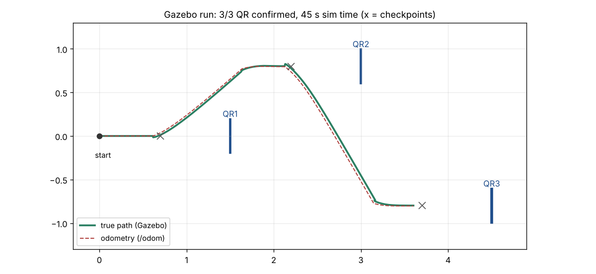
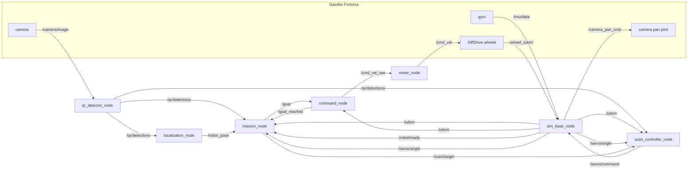

# QR Guidance Robot

A four-wheel mobile robot that finds its own position from QR codes. It drives to three QR panels in turn. At each one it locates the QR with a camera on a pan servo, steers onto it, computes where it really is from the QR's apparent size and position in the image, and cancels the odometry drift accumulated so far.

This repository is the full ROS 2 software running in simulation (**ROS 2 Humble** and **Gazebo Fortress**). Navigation, vision and control are the same nodes used on the real robot. Only the hardware layer is replaced by a simulated one.



## How it works

1. **Vision.** `qr_detector_node` decodes the camera image and publishes the QR id, its centre, its size in pixels and the capture time of the frame. `scan_controller_node` sweeps the camera servo until it sees the target QR, then keeps it in view while the robot turns.
2. **Localisation.** The distance to a QR is `k / apparent size`. The direction comes from the pixel position plus the camera pan angle. With the QR's known position in the world, `localization_node` computes a position fix.
3. **Mission.** `mission_node` sends the robot to an approach point, steers it onto the QR, waits for a fix, then corrects the `world → odom` transform so odometry agrees with the fix. It then moves to the next QR. A QR that gives no fix is retried twice, then reported as missed.
4. **Control.** `command_node` drives to a goal point using `/odom`. `motor_node` applies speed limits, acceleration ramps and a watchdog.

Odometry is wheel (or commanded) speed combined with gyro heading. The QRs correct position only, not heading.



## Packages

| Package | Role |
|---|---|
| `robot_description` | URDF (skid-steer base, camera on a pan joint, gyro, lidar), meshes, QR world, Gazebo launch, ROS to Gazebo bridge |
| `robot_sim` | `sim_base_node`, the simulated hardware layer: odometry, `/robot/ready`, camera servo protocol |
| `qr_guidance_robot` | `qr_detector_node` and `scan_controller_node` |
| `qr_navigation` | `localization_node` and `mission_node`, with the QR table and mission parameters |
| `robot_control` | `command_node` and `motor_node` |
| `qr_robot_bringup` | `full_system.launch.py` (starts everything) and `check_system` (PASS/FAIL report) |

## Quick start

Requires Ubuntu 22.04 and ROS 2 Humble (`ros-humble-desktop`).

```bash
sudo apt update
sudo apt install ros-humble-ros-gz ros-humble-robot-state-publisher \
                 ros-humble-joint-state-publisher-gui ros-humble-rviz2 \
                 ros-humble-rqt-image-view python3-opencv python3-numpy
```

Build and run (the repository root is the colcon workspace):

```bash
git clone https://github.com/<your-username>/qr-guidance-robot.git
cd qr-guidance-robot
source /opt/ros/humble/setup.bash
colcon build --symlink-install
source install/setup.bash

export ROS_DOMAIN_ID=0
ros2 launch qr_robot_bringup full_system.launch.py
```

Gazebo opens and the robot starts by itself after a few seconds. The mission lasts about 45 s of simulated time. Stop with Ctrl+C in the launch terminal.

To get an automatic PASS/FAIL report, run this in a second terminal while the mission runs:

```bash
cd qr-guidance-robot && source install/setup.bash && export ROS_DOMAIN_ID=0
ros2 run qr_robot_bringup check_system
```

### Launch options

| Option | Default | Effect |
|---|---|---|
| `gui` | `true` | Show the Gazebo window (`false` runs headless) |
| `rviz` | `false` | Also open RViz |
| `autostart` | `true` | Start the mission automatically (`false` waits for `/mission/start`) |
| `scan` | `true` | Sweep and track with the camera servo (`false` keeps it straight ahead) |

To start manually:

```bash
ros2 launch qr_robot_bringup full_system.launch.py autostart:=false
# once the log says "robot ready":
ros2 topic pub --once /mission/start std_msgs/msg/Empty "{}"
```

## Inspecting a run

| What | Command |
|---|---|
| Mission state | `ros2 topic echo /mission/status` |
| What the detector sees | `ros2 run rqt_image_view rqt_image_view /qr/debug_image` |
| Raw detections | `ros2 topic echo /qr/detections` |
| Goals sent to the controller | `ros2 topic echo /goal` |
| QR position fixes | `ros2 topic echo /robot_pose` |
| Camera servo angle (90 = straight ahead) | `ros2 topic echo /servo/angle` |

A healthy run ends with `Mission complete. confirmed=['WAYPOINT_1', 'WAYPOINT_2', 'WAYPOINT_3'] missed=[]` and the robot stopped near (3.6, -0.8).

Other launch files:
- `ros2 launch qr_guidance_robot sim_qr.launch.py` runs Gazebo and the detector only. The robot stays in front of the first QR.
- `ros2 launch robot_description display.launch.py` shows the robot model in RViz with joint sliders and no Gazebo.

## Configuration

| To change | Edit |
|---|---|
| QR panel positions | `robot_description/worlds/qr_world.sdf` and `qr_navigation/config/qr_table.yaml` (checkpoint = panel position minus 0.8 m along the robot's heading) |
| QR visiting order | `mission` in `qr_navigation/config/mission_params.yaml` |
| Stop distance in front of a QR | `standoff` in `mission_params.yaml` (also move the table checkpoints) |
| Robot speed | `max_v`, `max_w` of `command_node` and `max_linear`, `max_angular` of `motor_node` |
| QR size constant | `servo_k` in `mission_params.yaml` (re-measured at the first QR when `auto_calibrate` is on) |
| Minimum QR size for a fix | `min_width_px` of `localization_node` in `full_system.launch.py` |

To add a QR, generate an image that encodes the new id, put it in `worlds/materials/textures/`, add a panel in `qr_world.sdf`, then add the id to `qr_table.yaml` and to `mission`. Rebuild afterwards.

## Tests

Unit tests (pure Python, no Gazebo, 27 tests covering geometry, frames, the servo model and gyro calibration):

```bash
cd src
PYTHONPATH=robot_control:qr_navigation:robot_sim:qr_guidance_robot python3 -m pytest \
    qr_navigation/test/test_mission_logic.py qr_navigation/test/test_slew.py \
    robot_sim/test qr_guidance_robot/test
```

System test: `check_system`, as shown in the quick start. It verifies that every node runs, that camera, odometry, gyro, servo and detections flow, and that the mission ends `DONE` with no QR missed.

## Results

Measured headless in Gazebo Fortress 6.16, with ground truth read from Gazebo.

| Measure | Result |
|---|---|
| Missions completed | 4 of 4 consecutive runs, all 3 QRs confirmed at the first attempt |
| Mission duration | about 45 s of simulated time |
| `check_system` | 17 of 17 checks pass |
| Position fix error vs. ground truth | 3.2 cm median, 3.4 cm max (9 fixes) |
| Wrong start position (0.20 m) | corrected at the first QR |

## Limitations

- QRs correct position, not heading. A start heading error of *e* rad shifts later fixes sideways by about 0.9·*e* m, so the robot must start at (0, 0) facing +x.
- The robot stops 0.85 to 0.90 m from each QR (stand-off 0.8 m plus a tolerance of up to 0.12 m).
- No obstacle avoidance or path planning. The lidar is simulated but not used.
- Mission order and QR table are fixed.
- `guidance_node` and `nav.launch.py` in `qr_navigation` are an earlier stand-alone guidance kept for reference. Do not launch them with the full system, since they also command the wheels.

## Troubleshooting

| Symptom | Cause and fix |
|---|---|
| Robot never moves, log says `waiting for /robot/ready` | The gyro is calibrated while the robot is still, 2 to 3 s after spawn. Check that `/imu/data` streams |
| `No image received yet` | Gazebo's camera needs OpenGL. Check the graphics driver or run with the GUI |
| QR panels are black | Textures are resolved at launch into `/tmp/qr_world_resolved.sdf`. Rebuild and relaunch |
| `N publishers on /cmd_vel` or `/odom`, robot stops | Two launches at once, or another ROS system on the same `ROS_DOMAIN_ID` |
| Odd behaviour after a crash | An old Gazebo server is still running: `pkill -9 -f "ign gazebo"` |
| A QR is reported `missed` | The log shows the last detection (`w=..px`). Too small means too far, no detection means not decoded |
| `colcon build` rejects `--editable` | Too recent a `setuptools`. Build without `--symlink-install` |

## Simulation vs. real robot

| Real robot | Simulation |
|---|---|
| Raspberry Pi and Arduino Mega over USB serial | `robot_sim/sim_base_node`, same ROS topics |
| USB camera on an SG90 servo | Gazebo camera on `camera_pan_joint`, same servo commands |
| 4 DC motors through two L298N drivers | Gazebo DiffDrive plugin |
| MPU-6050 gyro, bias measured at power-on | Gazebo IMU with bias and noise, bias measured the same way |
| `/odom` from commanded speed and gyro heading | `/odom` from wheel speed and gyro heading (`linear_source: command` mimics the robot) |

The hardware bridge package of the real robot is not part of this repository.

## Authors

- Emna Ghorbel
- Ichrak Ayadi

Developed as a robotics course project at ENIT (École Nationale d'Ingénieurs de Tunis).
